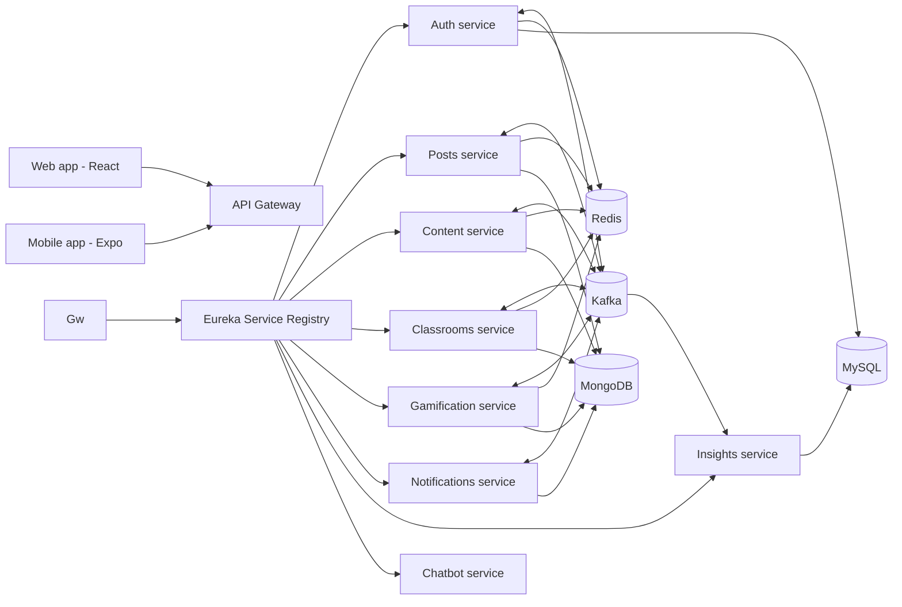

# SnapLearn

A collaborative learning platform that connects students, teachers, and parents: it provides students with access to lessons and assignments, offers teachers tools for class management and progress tracking, and gives parents real-time visibility. What sets it apart from traditional EdTech platforms is its collaborative classroom spaces, which allow students to work and interact with one another in real time.

🔗 **[Live demo](http://snaplearn.ddns.net:3000)**

[SnapLearn](https://youtu.be/fBgdMR0KsB8?si=i-FO2NK578FPjUBU)

## Features

- **Collaborative classrooms:** three-phase sessions (individual writing → peer review → consensus) with a rich-text editor and editing locks
- **Social learning feed:** posts, comments, and interactions between learners
- **Courses and assignments:** content and assignment management for teachers
- **Gamification:** XP, achievements, missions, and leaderboards to keep learners motivated
- **Performance dashboard:** analytics so students can track their progress
- **AI assistant:** a chatbot running a local LLM (Llama 3.2 via Ollama)
- **Real-time notifications**
- **Role-based access:** students, teachers, and administrators (with report handling)
- **Web and mobile apps**

## 🏗️ Architecture

SnapLearn is built as a set of independent microservices behind an API gateway, communicating through events.

| Component | Role |
|---|---|
| Spring Cloud Gateway | Single entry point, JWT validation (web cookies and mobile tokens) |
| Eureka | Service discovery |
| Kafka | Event-driven communication between services |
| Redis | Caching, token blacklist, leaderboards, distributed locks |
| Docker Compose | Orchestration, health checks, restart policies, replicas for scaling |

## Tech Stack

| Layer | Technologies |
|---|---|
| Frontend | React, JoditEditor |
| Mobile | React Native (Expo) |
| Backend | Spring Boot / Spring Cloud, Node.js, Python (FastAPI) |
| Databases | MySQL, MongoDB |
| Messaging and cache | Kafka, Redis |
| AI | Ollama (Llama 3.2) |
| Media | Cloudinary |
| DevOps | Docker, Docker Compose |

## Founder

- **Ayet Halima Derki** · [GitHub](https://github.com/DerkiAyet) · [LinkedIn](https://www.linkedin.com/in/derki-ayet-35999931a)

## Context

Started as a final-year engineering project (PFE) at ESI Sidi Bel Abbès.
